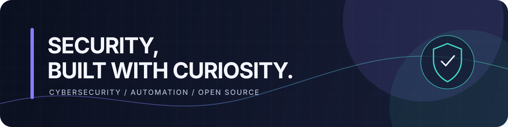

  
  <h1>Hey, I'm Steven 👋</h1>
  
<strong>Cybersecurity enthusiast · Automation builder · Open-source contributor</strong>

  
Curious about how things work—and how to make them safer, smarter, and more useful.

  
<a href="https://github.com/securitysteven">Explore my GitHub profile</a>

---

### 👨‍💻 A little about me

- 🔐 Interested in security research, penetration testing, and secure coding
- ⚙️ I enjoy turning repetitive work into useful automation
- 🌱 Exploring AI assistants and agents, machine learning operations, and infrastructure
- 🤝 Always happy to learn from and contribute to the open-source community

### 📊 GitHub snapshot

  

Profile metrics refresh automatically each day.

---

  Building, learning, and sharing—one project at a time.

